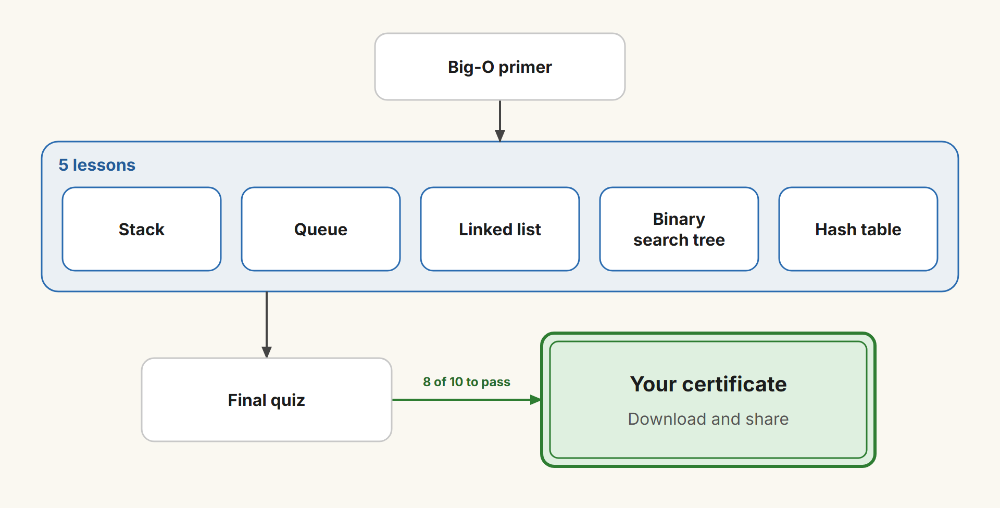
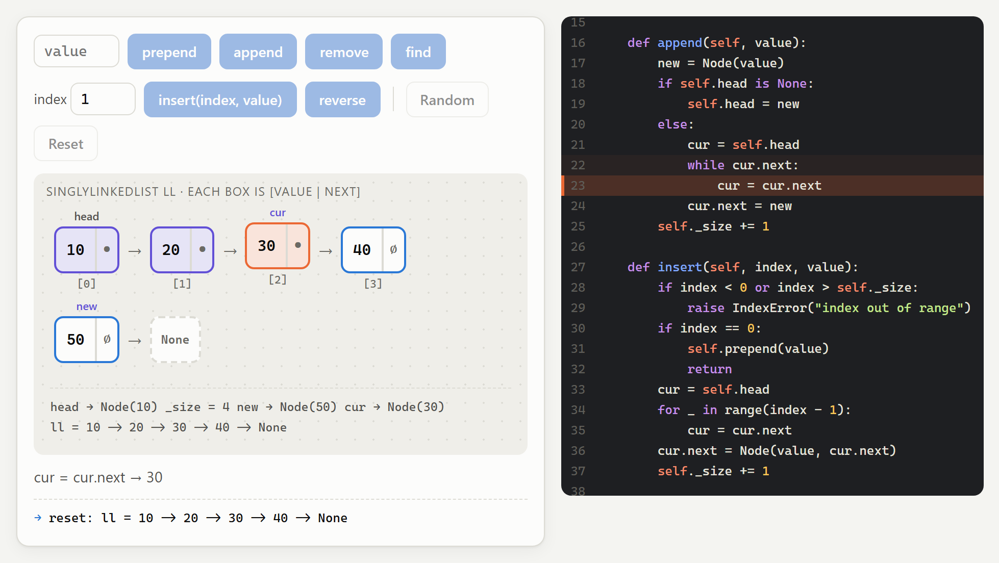
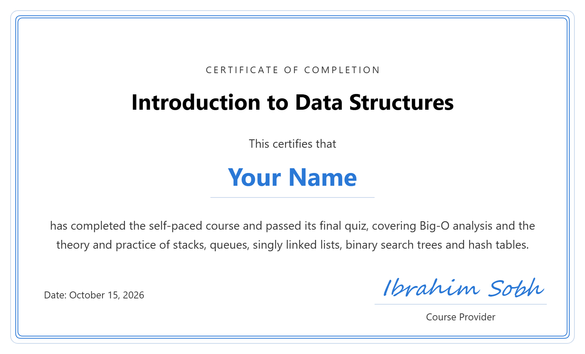

# Introduction to Data Structures

A **self-paced online course, completely free**, covering the basic data structures every software developer should know and understand: stacks, queues, singly linked lists, binary search trees and hash tables. It starts with a short primer on Big-O, and each lesson pairs the essential theory with interactive animations and hands-on practice.

**The certificate is free too.** No sign-up and no fees: pass the final quiz and get a certificate with your name.

## 🚀 Take the course: [ibrahimsobh.github.io/introduction-to-data-structures](https://ibrahimsobh.github.io/introduction-to-data-structures/)

✅ Free · no sign-up · runs in your browser

## What you'll learn

- How stacks, queues, linked lists, binary search trees and hash tables work inside.
- How fast each operation is, using Big-O, and how to choose the right structure.
- How each structure maps to real Python code, line by line, with animations.

## Main audience

Programmers who know the basics and want a solid understanding of the core data structures. The code is in Python, so some basic programming helps.

- **Computer science students** taking a first data structures course, or revising for exams.
- **Self-taught and bootcamp developers** who want to fill the gap in the fundamentals.
- **Developers preparing for coding interviews** who need the basics clear and quick.
- **Junior developers** who use lists and dictionaries every day and want to know what happens underneath.

It isn't aimed at readers looking for advanced structures (such as graphs, heaps or balanced trees) or formal proofs.

## What each lesson gives you

- **A clear description** of how the structure works and where it's used in real software.
- **Figures** that show the shape of the structure: nodes, pointers, stacks, trees and buckets.
- **Real source code** in Python for every operation.
- **Interactive animations** that link the two: run an operation and watch the figure change while the exact line of code that does it is highlighted.

**Example: appending to a linked list.** The pointer `cur` walks along the chain in the figure, while line 23 `cur = cur.next` lights up in the code beside it, and a note explains each step.

## How long it takes

About 3 hours if you're new to programming, or about 1.5 hours if you already program.

| Part | New to programming | Already program |
|---|---|---|
| Big-O primer | 20 min | 5 min |
| 5 lessons (theory, animation, quiz) | 5 × 30 min = 150 min | 5 × 15 min = 75 min |
| Choosing a structure and the cheat sheet | 10 min | 5 min |
| Final quiz and certificate | 15 min | 10 min |
| **Total** | **195 min ≈ 3 hours** | **95 min ≈ 1.5 hours** |

## Final quiz and certificate

Finish with the final quiz. Score 8 of 10 or more to get a certificate with your name, which you can download as an image or save as a PDF and share.

**Here's what your certificate looks like:**

Everything runs in your browser. Nothing you enter, including your name, is sent anywhere.
